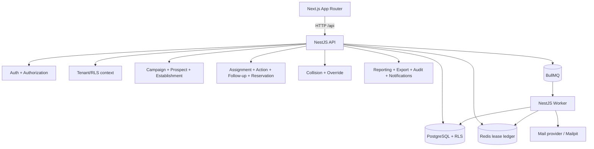

# TrackRoster architecture notes

Audit date: 2026-10-12. This document describes the repository as inspected; it does not prescribe a redesign.

## Workspace shape

The repository is a pnpm workspace (`apps/*`, `packages/*`) using pnpm 11.24.0. The production applications are:

| Package      | Path                  | Runtime                                                         |
| ------------ | --------------------- | --------------------------------------------------------------- |
| `api`        | `apps/api`            | NestJS + Fastify, Drizzle ORM, `pg`, Redis/BullMQ integrations  |
| `web`        | `apps/web`            | Next.js 16 App Router, React 19                                 |
| `worker`     | `apps/worker`         | NestJS worker, BullMQ consumers, Drizzle/`pg`                   |
| `jobs`       | `packages/jobs`       | shared job contracts/runtime package                            |
| `config`     | `packages/config`     | shared TypeScript configuration                                 |
| `types`      | `packages/types`      | shared type package (currently only package metadata was found) |
| `ui`         | `packages/ui`         | shared UI package                                               |
| `validation` | `packages/validation` | shared validation package                                       |

The declared README still describes TypeORM in places, while the executable API uses Drizzle (`apps/api/src/database/database.provider.ts:3-4`). That is documentation drift, not an ORM migration in progress.

## API module map

`apps/api/src/app.module.ts:1-131` composes the application. The major domains are:

- Organization/control: `TenantModule`, `OrganizationModule`, `TeamModule`, `UserModule`, `MembershipModule`, `SecurityAdministrationModule`, `WorkspaceAdministrationModule`, `AuthorizationModule`, `ComplianceModule`.
- Market: `EstablishmentModule`, `EstablishmentContactsModule`, `CampaignModule`, `CampaignOrganizationModule`, `ProspectMasterModule`, `ProspectEnrichmentModule`, `SearchModule`, `RegionModule`, `TerritoryModule`, `GeographicAllocationModule`.
- Execution: `AssignmentModule`, `ParticipationModule`, `ReservationModule`, `ReservationLifecycleModule`, `ActionModule`, `FollowUpModule`, `WorkQueueModule`, `ProspectorTodayModule`, `CommunicationsModule`.
- Control/oversight: `CollisionModule`, `CollisionWorkflowModule`, `ReportingModule`, `ExportModule`, `ActivityModule`, `NotificationModule`, `ScheduledReportsModule`, `SavedViewsModule`, audit services.
- Infrastructure: `DatabaseModule`, `RedisModule`, `JobQueueModule`, `ProvidersModule`, `IntegrationsModule`, `HealthModule`, `IdempotencyModule`, `ApiErrorModule`.

`DatabaseModule` is global and provides the API pool, Drizzle database and tenant transaction interceptor. `AuthModule` supplies JWT/session guards. Controller → service → repository layering is the common shape; Drizzle schema lives under `apps/api/src/database/schema`.

The worker is a separate Nest application. Its database module creates a separate pool (`apps/worker/src/database/worker-database.module.ts:8-56`) and its consumer concurrency is five jobs (`apps/worker/src/jobs/job-consumer.service.ts:123-129`).

## Database and tenant flow

The API creates one `pg.Pool` per API process, default max eight and bounded to 1–15 (`apps/api/src/database/database.provider.ts:58-83`). The worker creates one pool per worker process, default max four and bounded to 1–15 (`apps/worker/src/database/worker-database.module.ts:15-47`). The theoretical default is therefore 12 backend connections per API+worker replica pair, multiplied by replicas. RLS is enabled and forced by migrations 0071/0073; the runtime role is deliberately non-owner/non-BYPASSRLS (`infrastructure/docker/postgres/init/01-runtime-role.sql:1-44`).

For authenticated HTTP requests, `TenantTransactionInterceptor` opens a Drizzle transaction, sets tenant context and runs the entire handler observable before commit (`apps/api/src/database/tenant-transaction.interceptor.ts:19-57`). This makes tenant context central, but also holds a client for the complete request.

## Representative write path: `POST /actions`

1. `ActionController` receives the DTO under `apps/api/src/actions/action.controller.ts:64-77`; global validation is configured in `apps/api/src/config/http-application.ts:5-17`.
2. `ActionService` validates the authenticated assignment and writes the action row in a Drizzle transaction (`apps/api/src/actions/action.service.ts:300-364`).
3. Completion updates outcome/activity/lifecycle/consent/follow-up records and appends an action event/audit entry in the same SQL transaction (`apps/api/src/actions/action.service.ts:650-683`).
4. A reservation release is recorded as an `actionEffects` row (`apps/api/src/actions/action.service.ts:690-706`). Actual Redis release is deferred to effect processing, so the durable action transaction and external lock release are not one atomic system transaction.
5. `ApiExceptionFilter` maps errors to a request-correlated, sanitized envelope (`apps/api/src/errors/api-exception.filter.ts:37-84`).

## Representative read path: `GET /manager/dashboard`

The route is provided by `ManagerDashboardController` (`apps/api/src/reporting/manager-dashboard.controller.ts:10-29`) and delegates to reporting/manager dashboard scope services. The service resolves the caller tenant, organization/team scope, period and filters before repository queries. The result is read-only and the controlled export path reuses the same scope resolver before serialising and auditing (`apps/api/src/exports/controlled-export.service.ts:60-160`).

## Next.js route tree

The frontend uses the App Router under `apps/web/src/app`, with an `(app)` route group and role-specific segments including `admin`, `director`, `manager`, `observer`, `platform`, `prospector`, `settings`, `accept-invitation`, `landing` and authentication routes. The application layout is server-rendered unless a leaf explicitly opts into `"use client"`; no top-level global layout was found to be client-only during this static pass.

The frontend has server/API route forwarders under `apps/web/src/app/api` and typed request helpers under `apps/web/src/lib/api`. Search and collision decisions come from the API; UI role checks are used for navigation/visibility only.

## HTTP endpoint inventory

The following is the route inventory derived from `rg -n "@(Controller|Get|Post|Patch|Delete|Put)\(" apps/api/src` and controller prefixes. Nest applies the global `/api` prefix/versioning configured in `http-application.ts`.

| Controller prefix                                                 | Registered operations                                                                                                                            |
| ----------------------------------------------------------------- | ------------------------------------------------------------------------------------------------------------------------------------------------ |
| `auth`                                                            | `GET config`, `POST login`, `POST select-tenant`, `POST refresh`, `POST logout`, `GET me`; password recovery and MFA add their documented routes |
| `auth/mfa`                                                        | enroll, verify, recovery, regenerate recovery codes, delete                                                                                      |
| `auth/sso`                                                        | provider start/callback/refresh                                                                                                                  |
| `users`                                                           | list, create, status update                                                                                                                      |
| `memberships` / `invitations`                                     | membership invite/resend and invitation read/accept                                                                                              |
| `platform/invitations` / `platform/users`                         | platform invite and access-grant lifecycle                                                                                                       |
| `establishments`                                                  | create, list, nearby, detail, update                                                                                                             |
| `establishments/:establishmentId/contacts`                        | create, list, detail, update                                                                                                                     |
| `campaigns/:campaignId/prospects/:prospectId`                     | assignment create/update/delete, assignment detail/history                                                                                       |
| `assignments`                                                     | list, unassigned, create/detail/update, reassign/complete/revoke, batch preview/apply                                                            |
| `reservation-rules` / `reservations`                              | rule CRUD; list/claim/detail/heartbeat/extend/release                                                                                            |
| `campaigns/:campaignId/prospects/:prospectId/reservation`         | reservation create/list/delete                                                                                                                   |
| `actions` / collision workflow                                    | action lifecycle and override request/decision routes                                                                                            |
| `search`                                                          | search and facets                                                                                                                                |
| `prospector/today`                                                | today queue                                                                                                                                      |
| `tags` / `custom-fields` / `prospect-duplicates` / `data-quality` | enrichment and duplicate-resolution routes                                                                                                       |
| `conversations` / `messages`                                      | conversation, participant, message, read, mute, edit/delete/reaction routes                                                                      |
| `notifications`                                                   | list, unread count, read-all, read                                                                                                               |
| `uploads` / attachment routes                                     | presign, attach, download                                                                                                                        |
| `health`                                                          | health/live/ready                                                                                                                                |
| `access-reviews` / `compliance-reports`                           | compliance review/report lifecycle                                                                                                               |
| `saved-views` / participation routes                              | saved-view CRUD and territory/team membership CRUD                                                                                               |
| `campaigns/:campaignId/geographic-allocation`                     | preview/apply                                                                                                                                    |
| `consent`                                                         | consent list/create                                                                                                                              |
| reporting/export                                                  | manager dashboard/report and controlled export controllers                                                                                       |

The audit did not start a running server or query Nest's runtime route table; this table is a source scan and is static.

## Dependency direction and boundaries

Controllers depend on services and DTOs; services depend on Drizzle repositories/query helpers. RLS/tenant context is set centrally by database helpers and the request interceptor. Redis is used for reservation ledger/atomic lease operations; PostgreSQL stores durable reservation/action/audit state. BullMQ consumes asynchronous jobs for exports, notifications, imports and effects.

No TypeORM entities were found in the executable API; schema is Drizzle table definitions. No `synchronize` configuration was found outside test discussions; schema changes are represented by 92 SQL migrations.

## Mermaid module graph



## Verification limits

Root `pnpm -r exec tsc --noEmit`, `pnpm lint`, `pnpm test -- --passWithNoTests`, and `pnpm --filter web build` were each started and interrupted after roughly 60 seconds without output in this environment. `pnpm install --frozen-lockfile` and `pnpm audit --prod` were not run because they would require network/package-manager access outside the read-only audit contract. Historical focused checks recorded before this audit passed API TypeScript, the full API suite (240 files/1,766 tests), focused web tests (2 files/47 tests), focused web lint/typecheck/format, and the API build; they are not a replacement for the current root baseline.

## Raw controller decorator inventory

The grouped table above is the human-readable inventory. The following is the exact source scan used to build it; it includes every controller and HTTP decorator match found under apps/api/src.

```text
apps/api/src/prospector-today/prospector-today.controller.ts:10:@Controller('prospector/today')
apps/api/src/prospector-today/prospector-today.controller.ts:15:  @Get()
apps/api/src/search/search.module.ts:206:@Controller('search')
apps/api/src/search/search.module.ts:210:  @Get('facets') facets(@CurrentAuth() auth: Auth, @Query() query: SearchQuery) {
apps/api/src/search/search.module.ts:214:  @Get() search(@CurrentAuth() auth: Auth, @Query() query: SearchQuery) {
apps/api/src/geographic-allocation/allocation.controller.ts:38:@Controller('campaigns/:campaignId/geographic-allocation')
apps/api/src/geographic-allocation/allocation.controller.ts:42:  @Post('preview')
apps/api/src/geographic-allocation/allocation.controller.ts:51:  @Post('apply')
apps/api/src/communications/communications.module.ts:179:@Controller()
apps/api/src/communications/communications.module.ts:183:  @Post('uploads/presign') @Idempotent('upload.presign') presign(
apps/api/src/communications/communications.module.ts:189:  @Post('messages/:messageId/attachments') @Idempotent('message.attachment') attach(
apps/api/src/communications/communications.module.ts:196:  @Get('attachments/:attachmentId/download') download(
apps/api/src/communications/communications.module.ts:202:  @Get('notification-preferences') preferences(@CurrentAuth() a: Auth) {
apps/api/src/communications/communications.module.ts:205:  @Put('notification-preferences') setPreferences(
apps/api/src/communications/communications.module.ts:211:  @Post('devices') @Idempotent('device.register') device(
apps/api/src/communications/communications.module.ts:217:  @Delete('devices/:deviceId') revoke(
apps/api/src/actions/action.controller.ts:64:@Controller('actions')
apps/api/src/actions/action.controller.ts:68:  @Get() list(@CurrentAuth() a: AuthenticatedPrincipal, @Query() q: ListActionsDto) {
apps/api/src/actions/action.controller.ts:71:  @Post()
apps/api/src/actions/action.controller.ts:78:  @Get(':actionId') detail(
apps/api/src/actions/action.controller.ts:84:  @Get(':actionId/events') events(
apps/api/src/actions/action.controller.ts:91:  @Patch(':actionId')
apps/api/src/actions/action.controller.ts:102:  @Post(':actionId/start')
apps/api/src/actions/action.controller.ts:114:  @Post(':actionId/complete')
apps/api/src/actions/action.controller.ts:126:  @Post(':actionId/cancel')
apps/api/src/actions/action.controller.ts:138:  @Post(':actionId/corrections')
apps/api/src/health/readiness.controller.ts:8:@Controller('health')
apps/api/src/health/readiness.controller.ts:17:  @Get('live')
apps/api/src/health/readiness.controller.ts:22:  @Get('ready')
apps/api/src/compliance/compliance.module.ts:172:@Controller()
apps/api/src/compliance/compliance.module.ts:176:  @Get('access-reviews') reviews(@CurrentAuth() a: Auth) {
apps/api/src/compliance/compliance.module.ts:179:  @Post('access-reviews') @Idempotent('access_review.create') start(@CurrentAuth() a: Auth) {
apps/api/src/compliance/compliance.module.ts:182:  @Get('access-reviews/:reviewId') review(
apps/api/src/compliance/compliance.module.ts:188:  @Get('access-reviews/:reviewId/memberships') members(
apps/api/src/compliance/compliance.module.ts:194:  @Post('access-reviews/:reviewId/decisions') decision(
apps/api/src/compliance/compliance.module.ts:201:  @Post('access-reviews/:reviewId/complete') @HttpCode(200) complete(
apps/api/src/compliance/compliance.module.ts:207:  @Get('compliance-reports') reports(@CurrentAuth() a: Auth) {
apps/api/src/compliance/compliance.module.ts:210:  @Post('compliance-reports') @Idempotent('compliance_report.create') create(
apps/api/src/compliance/compliance.module.ts:216:  @Get('compliance-reports/:reportId') report(
apps/api/src/compliance/compliance.module.ts:222:  @Get('compliance-reports/:reportId/download') download(
apps/api/src/data-jobs/import-job.controller.ts:46:@Controller('imports')
apps/api/src/data-jobs/import-job.controller.ts:50:  @Get() list(@CurrentAuth() a: AuthenticatedPrincipal, @Query() q: JobListDto) {
apps/api/src/data-jobs/import-job.controller.ts:53:  @Post() @Idempotent('import_job.create') create(@CurrentAuth() a: AuthenticatedPrincipal) {
apps/api/src/data-jobs/import-job.controller.ts:56:  @Get(':importId') detail(
apps/api/src/data-jobs/import-job.controller.ts:62:  @Post(':importId/file')
apps/api/src/data-jobs/import-job.controller.ts:83:  @Put(':importId/mapping') @Idempotent('import_job.mapping') mapping(
apps/api/src/data-jobs/import-job.controller.ts:91:  @Post(':importId/validate') @HttpCode(200) @Idempotent('import_job.validate') validate(
apps/api/src/data-jobs/import-job.controller.ts:98:  @Get(':importId/rows') rows(
apps/api/src/data-jobs/import-job.controller.ts:105:  @Get(':importId/issues') issues(
apps/api/src/data-jobs/import-job.controller.ts:112:  @Post(':importId/commit') @HttpCode(200) @Idempotent('import_job.commit') commit(
apps/api/src/data-jobs/import-job.controller.ts:119:  @Post(':importId/cancel') @HttpCode(200) @Idempotent('import_job.cancel') cancel(
apps/api/src/data-jobs/import-job.controller.ts:126:  @Get(':importId/report') async report(
apps/api/src/data-jobs/import-job.controller.ts:138:@Controller('import-issues')
apps/api/src/data-jobs/import-job.controller.ts:142:  @Patch(':issueId') @Idempotent('import_job.resolve') resolve(
apps/api/src/data-jobs/export-job.controller.ts:43:@Controller('exports')
apps/api/src/data-jobs/export-job.controller.ts:47:  @Post('preview') @HttpCode(200) preview(
apps/api/src/data-jobs/export-job.controller.ts:53:  @Get() list(@CurrentAuth() a: AuthenticatedPrincipal, @Query() q: JobListDto) {
apps/api/src/data-jobs/export-job.controller.ts:56:  @Post() @HttpCode(202) @Idempotent('export_job.create') create(
apps/api/src/data-jobs/export-job.controller.ts:62:  @Get(':exportId') detail(
apps/api/src/data-jobs/export-job.controller.ts:68:  @Post(':exportId/cancel') @HttpCode(200) @Idempotent('export_job.cancel') cancel(
apps/api/src/data-jobs/export-job.controller.ts:74:  @Get(':exportId/download') download(
apps/api/src/data-jobs/export-job.controller.ts:80:  @Get(':exportId/audit') audit(
apps/api/src/data-jobs/export-job.controller.ts:87:  @Get(':exportId/file') async file(
apps/api/src/permissions/permission.controller.ts:38:@Controller('roles')
apps/api/src/permissions/permission.controller.ts:43:  @Get() list() {
apps/api/src/permissions/permission.controller.ts:46:  @Get(':role/permissions')
apps/api/src/permissions/permission.controller.ts:82:  @Put(':role/permissions')
apps/api/src/permissions/permission.controller.ts:137:@Controller('permissions')
apps/api/src/permissions/permission.controller.ts:140:  @Get() list() {
apps/api/src/health/health.controller.ts:3:@Controller('health')
apps/api/src/health/health.controller.ts:5:  @Get()
apps/api/src/consents/consent.controller.ts:39:@Controller('prospects/:prospectId/consents')
apps/api/src/consents/consent.controller.ts:43:  @Get() list(
apps/api/src/consents/consent.controller.ts:50:  @Post()
apps/api/src/tenants/platform-user.controller.ts:14:@Controller('platform/users')
apps/api/src/tenants/platform-user.controller.ts:21:  @Get()
apps/api/src/tenants/platform-user.controller.ts:40:  @Post(':identityId/grants')
apps/api/src/tenants/platform-user.controller.ts:69:  @Post(':identityId/grants/:grantId/revoke')
apps/api/src/memberships/membership.controller.ts:29:@Controller('memberships')
apps/api/src/memberships/membership.controller.ts:34:  @Get() list(@CurrentAuth() auth: AuthenticatedPrincipal, @Query() query: ListMembershipsDto) {
apps/api/src/memberships/membership.controller.ts:37:  @Get(':membershipId') get(
apps/api/src/memberships/membership.controller.ts:43:  @Patch(':membershipId')
apps/api/src/memberships/membership.controller.ts:53:  @Post(':membershipId/suspend')
apps/api/src/memberships/membership.controller.ts:69:  @Post(':membershipId/reactivate')
apps/api/src/memberships/membership.controller.ts:80:  @Get(':membershipId/scopes') scopes(
apps/api/src/memberships/membership.controller.ts:86:  @Post(':membershipId/scopes')
apps/api/src/memberships/membership.controller.ts:95:  @Get(':membershipId/access-history') history(
apps/api/src/memberships/membership.controller.ts:103:@Controller('membership-scopes')
apps/api/src/memberships/membership.controller.ts:108:  @Patch(':scopeId')
apps/api/src/memberships/membership.controller.ts:118:  @Delete(':scopeId')
apps/api/src/actions/unified-timeline.controller.ts:12:@Controller('prospects/:prospectId/timeline')
apps/api/src/actions/unified-timeline.controller.ts:16:  @Get() list(
apps/api/src/account/account.controller.ts:31:@Controller('me')
apps/api/src/account/account.controller.ts:41:  @Get()
apps/api/src/account/account.controller.ts:46:  @Patch()
apps/api/src/account/account.controller.ts:56:  @Get('memberships')
apps/api/src/account/account.controller.ts:61:  @Get('permissions')
apps/api/src/account/account.controller.ts:66:  @Post('active-membership')
apps/api/src/account/account.controller.ts:75:  @Get('preferences')
apps/api/src/account/account.controller.ts:80:  @Patch('preferences')
apps/api/src/account/account.controller.ts:90:  @Get('sessions')
apps/api/src/account/account.controller.ts:95:  @Delete('sessions/others')
apps/api/src/account/account.controller.ts:101:  @Delete('sessions/:sessionId')
apps/api/src/objectives/objective.controller.ts:54:@Controller('objectives')
apps/api/src/objectives/objective.controller.ts:58:  @Get() list(@CurrentAuth() a: Actor, @Query() q: ObjectiveListDto) {
apps/api/src/objectives/objective.controller.ts:61:  @Get('at-risk') risks(@CurrentAuth() a: Actor, @Query() q: ObjectiveListDto) {
apps/api/src/objectives/objective.controller.ts:68:  @Get(':objectiveId') detail(
apps/api/src/objectives/objective.controller.ts:74:  @Post() @UseGuards(ObjectiveWriteGuard) @Idempotent('objective.create') create(
apps/api/src/objectives/objective.controller.ts:80:  @Patch(':objectiveId') @UseGuards(ObjectiveWriteGuard) @Idempotent('objective.update') update(
apps/api/src/user-management/user-management.controller.ts:12:@Controller('users')
apps/api/src/user-management/user-management.controller.ts:17:  @Get()
apps/api/src/user-management/user-management.controller.ts:25:  @Post()
apps/api/src/user-management/user-management.controller.ts:40:  @Patch(':userId/status')
apps/api/src/security-administration/invitation.controller.ts:26:@Controller('memberships')
apps/api/src/security-administration/invitation.controller.ts:30:  @Post()
apps/api/src/security-administration/invitation.controller.ts:35:  @Post(':membershipId/resend-invite')
apps/api/src/security-administration/invitation.controller.ts:46:@Controller('platform/invitations')
apps/api/src/security-administration/invitation.controller.ts:51:  @Post()
apps/api/src/security-administration/invitation.controller.ts:60:@Controller('invitations')
apps/api/src/security-administration/invitation.controller.ts:64:  @Get(':token')
apps/api/src/security-administration/invitation.controller.ts:70:  @Post(':token/accept')
apps/api/src/imports/import-preview.controller.ts:30:@Controller('imports')
apps/api/src/imports/import-preview.controller.ts:35:  @Post('preview')
apps/api/src/reservations/reservation-lifecycle.controller.ts:77:@Controller('reservation-rules')
apps/api/src/reservations/reservation-lifecycle.controller.ts:81:  @Get() list(@CurrentAuth() a: AuthenticatedPrincipal, @Query() q: ReservationListDto) {
apps/api/src/reservations/reservation-lifecycle.controller.ts:84:  @Get(':ruleId') detail(
apps/api/src/reservations/reservation-lifecycle.controller.ts:90:  @Post() @Idempotent('reservation_rule.create') create(
apps/api/src/reservations/reservation-lifecycle.controller.ts:96:  @Patch(':ruleId') @Idempotent('reservation_rule.update') update(
apps/api/src/reservations/reservation-lifecycle.controller.ts:104:  @Delete(':ruleId') @Idempotent('reservation_rule.deactivate') remove(
apps/api/src/reservations/reservation-lifecycle.controller.ts:112:@Controller('reservations')
apps/api/src/reservations/reservation-lifecycle.controller.ts:116:  @Get() list(@CurrentAuth() a: AuthenticatedPrincipal, @Query() q: ReservationListDto) {
apps/api/src/reservations/reservation-lifecycle.controller.ts:119:  @Post('claim') @UseGuards(ReservationLifecycleGuard) @Idempotent('reservation.claim') claim(
apps/api/src/reservations/reservation-lifecycle.controller.ts:125:  @Get(':reservationId') detail(
apps/api/src/reservations/reservation-lifecycle.controller.ts:131:  @Post(':reservationId/heartbeat')
apps/api/src/reservations/reservation-lifecycle.controller.ts:141:  @Post(':reservationId/extend')
apps/api/src/reservations/reservation-lifecycle.controller.ts:152:  @Post(':reservationId/release')
apps/api/src/assignments/campaign-prospect-assignment.controller.ts:25:@Controller('campaigns/:campaignId/prospects/:prospectId')
apps/api/src/assignments/campaign-prospect-assignment.controller.ts:31:  @Post('assignment')
apps/api/src/assignments/campaign-prospect-assignment.controller.ts:61:  @Put('assignment')
apps/api/src/assignments/campaign-prospect-assignment.controller.ts:97:  @Delete('assignment')
apps/api/src/assignments/campaign-prospect-assignment.controller.ts:119:  @Get('assignment')
apps/api/src/assignments/campaign-prospect-assignment.controller.ts:134:  @Get('assignment-history')
apps/api/src/scripts/script.controller.ts:57:@Controller('scripts')
apps/api/src/scripts/script.controller.ts:61:  @Get() list(@CurrentAuth() auth: AuthenticatedPrincipal, @Query() query: ScriptQuery) {
apps/api/src/scripts/script.controller.ts:64:  @Get(':scriptId') get(
apps/api/src/scripts/script.controller.ts:70:  @Post() @UseGuards(ClientAdminGuard) @Idempotent('script.create') create(
apps/api/src/scripts/script.controller.ts:76:  @Patch(':scriptId') @UseGuards(ClientAdminGuard) @Idempotent('script.update') update(
apps/api/src/scripts/script.controller.ts:83:  @Delete(':scriptId') @UseGuards(ClientAdminGuard) @Idempotent('script.delete') remove(
apps/api/src/scripts/script.controller.ts:89:  @Post(':scriptId/preview') @UseGuards(ClientAdminGuard) preview(
apps/api/src/scripts/script.controller.ts:96:  @Post(':scriptId/test') @UseGuards(ClientAdminGuard) @Idempotent('script.test') test(
apps/api/src/imports/import-execution.controller.ts:36:@Controller('imports')
apps/api/src/imports/import-execution.controller.ts:41:  @Post('execute')
apps/api/src/tenants/platform-tenant.controller.ts:24:@Controller('platform/tenants')
apps/api/src/tenants/platform-tenant.controller.ts:32:  @Get()
apps/api/src/tenants/platform-tenant.controller.ts:42:  @Get(':tenantId')
apps/api/src/tenants/platform-tenant.controller.ts:49:  @Get(':tenantId/usage')
apps/api/src/tenants/platform-tenant.controller.ts:72:  @Get(':tenantId/config')
apps/api/src/tenants/platform-tenant.controller.ts:83:  @Patch(':tenantId/config')
apps/api/src/tenants/platform-tenant.controller.ts:108:  @Patch(':tenantId/status')
apps/api/src/saved-views/saved-views.module.ts:124:@Controller('saved-views')
apps/api/src/saved-views/saved-views.module.ts:128:  @Get() list(@CurrentAuth() a: Auth, @Query() q: ListSavedViewsDto) {
apps/api/src/saved-views/saved-views.module.ts:131:  @Post() @Idempotent('saved_view.create') create(
apps/api/src/saved-views/saved-views.module.ts:137:  @Patch(':viewId') update(
apps/api/src/saved-views/saved-views.module.ts:144:  @Delete(':viewId') @HttpCode(204) remove(
apps/api/src/audit/audit.controller.ts:23:@Controller('audit')
apps/api/src/audit/audit.controller.ts:169:  @Get('events') async list(
apps/api/src/audit/audit.controller.ts:194:  @Get('events/:eventId') async detail(
apps/api/src/audit/audit.controller.ts:206:  @Get('overview') async overview(@CurrentAuth() a: Auth) {
apps/api/src/audit/audit.controller.ts:218:  @Get('users/:membershipId/access') async access(
apps/api/src/audit/audit.controller.ts:230:  @Get('data-changes') data(@CurrentAuth() a: Auth, @Query() q: Record<string, string>) {
apps/api/src/audit/audit.controller.ts:233:  @Get('security-events') security(@CurrentAuth() a: Auth, @Query() q: Record<string, string>) {
apps/api/src/audit/audit.controller.ts:236:  @Get('security-events/:eventId') securityDetail(
apps/api/src/audit/audit.controller.ts:242:  @Get('assignments') assignments(@CurrentAuth() a: Auth, @Query() q: Record<string, string>) {
apps/api/src/audit/audit.controller.ts:245:  @Get('assignments/:assignmentId') assignment(
apps/api/src/audit/audit.controller.ts:251:  @Get('overrides') overrides(@CurrentAuth() a: Auth, @Query() q: Record<string, string>) {
apps/api/src/audit/audit.controller.ts:254:  @Get('overrides/:overrideId') override(@CurrentAuth() a: Auth, @Param('overrideId') id: string) {
apps/api/src/audit/audit.controller.ts:257:  @Get('collisions') collisions(@CurrentAuth() a: Auth, @Query() q: Record<string, string>) {
apps/api/src/audit/audit.controller.ts:260:  @Get('collisions/:collisionId') collision(
apps/api/src/audit/audit.controller.ts:266:  @Get('exports') exports(@CurrentAuth() a: Auth, @Query() q: Record<string, string>) {
apps/api/src/audit/audit.controller.ts:269:  @Get('exports/:exportId') export(@CurrentAuth() a: Auth, @Param('exportId') id: string) {
apps/api/src/audit/audit.controller.ts:272:  @Get('retention') retention(@CurrentAuth() a: Auth) {
apps/api/src/audit/audit.controller.ts:275:  @Post('evidence-exports') @HttpCode(202) async evidence(
apps/api/src/audit/audit.controller.ts:292:  @Get('evidence-exports/:exportId') async evidenceDetail(
apps/api/src/security-administration/security-policy.controller.ts:36:@Controller('settings/security')
apps/api/src/security-administration/security-policy.controller.ts:44:  @Get()
apps/api/src/security-administration/security-policy.controller.ts:55:  @Patch()
apps/api/src/establishments/establishment.controller.ts:27:@Controller('establishments')
apps/api/src/establishments/establishment.controller.ts:32:  @Post()
apps/api/src/establishments/establishment.controller.ts:49:  @Get()
apps/api/src/establishments/establishment.controller.ts:62:  @Get('nearby')
apps/api/src/establishments/establishment.controller.ts:83:  @Get(':establishmentId')
apps/api/src/establishments/establishment.controller.ts:98:  @Patch(':establishmentId')
apps/api/src/follow-ups/canonical-follow-up.controller.ts:54:@Controller('follow-ups')
apps/api/src/follow-ups/canonical-follow-up.controller.ts:58:  @Get(':followUpId') detail(
apps/api/src/follow-ups/canonical-follow-up.controller.ts:64:  @Patch(':followUpId') @UseGuards(FollowUpWriteGuard) @Idempotent('follow_up.update') update(
apps/api/src/follow-ups/canonical-follow-up.controller.ts:72:  @Post(':followUpId/complete')
apps/api/src/follow-ups/canonical-follow-up.controller.ts:83:  @Post(':followUpId/cancel')
apps/api/src/notifications/notification.controller.ts:26:@Controller('notifications')
apps/api/src/notifications/notification.controller.ts:31:  @Get()
apps/api/src/notifications/notification.controller.ts:60:  @Get('unread-count')
apps/api/src/notifications/notification.controller.ts:65:  @Post('read-all')
apps/api/src/notifications/notification.controller.ts:72:  @Post(':notificationId/read')
apps/api/src/notifications/notification.controller.ts:86:  @Patch(':notificationId/read')
apps/api/src/follow-ups/prospect-follow-up.controller.ts:28:@Controller('campaigns/:campaignId/prospects/:prospectId/follow-ups')
apps/api/src/follow-ups/prospect-follow-up.controller.ts:37:  @Get()
apps/api/src/follow-ups/prospect-follow-up.controller.ts:59:  @Post()
apps/api/src/follow-ups/prospect-follow-up.controller.ts:92:  @Patch(':followUpId/reschedule')
apps/api/src/follow-ups/prospect-follow-up.controller.ts:124:  @Post(':followUpId/complete')
apps/api/src/follow-ups/prospect-follow-up.controller.ts:151:  @Post(':followUpId/cancel')
apps/api/src/assignments/assignment-lifecycle.controller.ts:66:@Controller('assignments')
apps/api/src/assignments/assignment-lifecycle.controller.ts:70:  @Get() list(@CurrentAuth() a: AuthenticatedPrincipal, @Query() q: AssignmentListDto) {
apps/api/src/assignments/assignment-lifecycle.controller.ts:73:  @Get('unassigned') unassigned(
apps/api/src/assignments/assignment-lifecycle.controller.ts:79:  @Post()
apps/api/src/assignments/assignment-lifecycle.controller.ts:85:  @Get(':assignmentId') detail(
apps/api/src/assignments/assignment-lifecycle.controller.ts:91:  @Patch(':assignmentId')
apps/api/src/assignments/assignment-lifecycle.controller.ts:102:  @Post(':assignmentId/reassign')
apps/api/src/assignments/assignment-lifecycle.controller.ts:114:  @Post(':assignmentId/complete')
apps/api/src/assignments/assignment-lifecycle.controller.ts:126:  @Post(':assignmentId/revoke')
apps/api/src/prospect-master/prospect-master.controller.ts:66:@Controller('prospects')
apps/api/src/prospect-master/prospect-master.controller.ts:70:  @Get() list(@CurrentAuth() a: AuthenticatedPrincipal, @Query() q: ListProspectsDto) {
apps/api/src/prospect-master/prospect-master.controller.ts:73:  @Post()
apps/api/src/prospect-master/prospect-master.controller.ts:80:  @Get(':prospectId')
apps/api/src/prospect-master/prospect-master.controller.ts:97:  @Get(':prospectId/campaign-memberships')
apps/api/src/prospect-master/prospect-master.controller.ts:104:  @Patch(':prospectId')
apps/api/src/prospect-master/prospect-master.controller.ts:115:  @Delete(':prospectId')
apps/api/src/prospect-master/prospect-master.controller.ts:125:  @Post(':prospectId/restore')
apps/api/src/prospect-master/prospect-master.controller.ts:136:  @Get(':prospectId/addresses') addresses(
apps/api/src/prospect-master/prospect-master.controller.ts:143:  @Post(':prospectId/addresses')
apps/api/src/prospect-master/prospect-master.controller.ts:154:  @Get(':prospectId/contacts') contacts(
apps/api/src/prospect-master/prospect-master.controller.ts:161:  @Post(':prospectId/contacts')
apps/api/src/prospect-master/prospect-master.controller.ts:173:@Controller('prospect-addresses')
apps/api/src/prospect-master/prospect-master.controller.ts:177:  @Patch(':addressId')
apps/api/src/prospect-master/prospect-master.controller.ts:187:  @Delete(':addressId')
apps/api/src/prospect-master/prospect-master.controller.ts:197:@Controller('prospect-contacts')
apps/api/src/prospect-master/prospect-master.controller.ts:201:  @Patch(':contactId')
apps/api/src/prospect-master/prospect-master.controller.ts:211:  @Delete(':contactId')
apps/api/src/assignments/assignment-batch.controller.ts:79:@Controller('assignments')
apps/api/src/assignments/assignment-batch.controller.ts:83:  @Post('preview')
apps/api/src/assignments/assignment-batch.controller.ts:88:  @Post('bulk')
apps/api/src/assignments/assignment-batch.controller.ts:94:@Controller('assignment-rules')
apps/api/src/assignments/assignment-batch.controller.ts:101:  @Get() list(@CurrentAuth() a: AuthenticatedPrincipal, @Query() q: AssignmentRuleListDto) {
apps/api/src/assignments/assignment-batch.controller.ts:104:  @Post()
apps/api/src/assignments/assignment-batch.controller.ts:109:  @Patch(':ruleId')
apps/api/src/assignments/assignment-batch.controller.ts:119:  @Delete(':ruleId')
apps/api/src/assignments/assignment-batch.controller.ts:128:  @Post(':ruleId/simulate')
apps/api/src/assignments/assignment-batch.controller.ts:140:@Controller('assignment-suggestions')
apps/api/src/assignments/assignment-batch.controller.ts:144:  @Get() async suggest(
apps/api/src/campaigns/campaign.controller.ts:33:@Controller('campaigns')
apps/api/src/campaigns/campaign.controller.ts:41:  @Post()
apps/api/src/campaigns/campaign.controller.ts:55:  @Get()
apps/api/src/campaigns/campaign.controller.ts:64:  @Get(':campaignId')
apps/api/src/campaigns/campaign.controller.ts:76:  @Patch(':campaignId')
apps/api/src/campaigns/campaign.controller.ts:94:  @Post(':campaignId/status')
apps/api/src/campaigns/campaign.controller.ts:108:  @Delete(':campaignId')
apps/api/src/exports/controlled-export.controller.ts:15:@Controller('exports')
apps/api/src/exports/controlled-export.controller.ts:20:  @Get('assignments') assignments(
apps/api/src/exports/controlled-export.controller.ts:26:  @Get('activities') activities(
apps/api/src/exports/controlled-export.controller.ts:32:  @Get('follow_ups') followUps(
apps/api/src/integrations/integrations.module.ts:259:@Controller()
apps/api/src/integrations/integrations.module.ts:263:  @Get('integrations') list(@CurrentAuth() a: Auth) {
apps/api/src/integrations/integrations.module.ts:266:  @Post('integrations/:provider/connect') @Idempotent('integration.connect') connect(
apps/api/src/integrations/integrations.module.ts:279:  @Get('integrations/:provider/callback') callback(
apps/api/src/integrations/integrations.module.ts:285:  @Post('integrations/:integrationId/test') test(
apps/api/src/integrations/integrations.module.ts:291:  @Post('integrations/:integrationId/sync') sync(
apps/api/src/integrations/integrations.module.ts:297:  @Get('integrations/:provider/health') health(
apps/api/src/integrations/integrations.module.ts:303:  @Delete('integrations/:integrationId') @HttpCode(204) remove(
apps/api/src/integrations/integrations.module.ts:309:  @Get('api-clients') clients(@CurrentAuth() a: Auth) {
apps/api/src/integrations/integrations.module.ts:312:  @Post('api-clients') @Idempotent('api_client.create') createClient(
apps/api/src/integrations/integrations.module.ts:318:  @Patch('api-clients/:clientId') updateClient(
apps/api/src/integrations/integrations.module.ts:325:  @Delete('api-clients/:clientId') @HttpCode(204) revokeClient(
apps/api/src/integrations/integrations.module.ts:331:  @Post('api-clients/:clientId/rotate-secret') rotate(
apps/api/src/integrations/integrations.module.ts:337:  @Get('webhooks') hooks(@CurrentAuth() a: Auth) {
apps/api/src/integrations/integrations.module.ts:340:  @Post('webhooks') @Idempotent('webhook.create') createHook(
apps/api/src/integrations/integrations.module.ts:346:  @Patch('webhooks/:webhookId') updateHook(
apps/api/src/integrations/integrations.module.ts:353:  @Delete('webhooks/:webhookId') @HttpCode(204) deleteHook(
apps/api/src/integrations/integrations.module.ts:359:  @Post('webhooks/:webhookId/test') testHook(
apps/api/src/integrations/integrations.module.ts:365:  @Get('webhooks/:webhookId/deliveries') deliveries(
apps/api/src/integrations/integrations.module.ts:371:  @Get('webhook-deliveries/:deliveryId') delivery(
apps/api/src/integrations/integrations.module.ts:377:  @Post('webhook-deliveries/:deliveryId/retry') retry(
apps/api/src/outcome-settings/outcome-settings.controller.ts:67:@Controller('settings/default-statuses')
apps/api/src/outcome-settings/outcome-settings.controller.ts:71:  @Get() read(@CurrentAuth() a: AuthenticatedPrincipal) {
apps/api/src/outcome-settings/outcome-settings.controller.ts:74:  @Patch() @UseGuards(SettingsGuard) @Idempotent('outcome_settings.update') update(
apps/api/src/collisions/collision-decision.controller.ts:13:@Controller('campaigns/:campaignId/prospects/:prospectId/collision-decision')
apps/api/src/collisions/collision-decision.controller.ts:18:  @Get()
apps/api/src/scheduled-reports/scheduled-reports.module.ts:142:@Controller('scheduled-reports')
apps/api/src/scheduled-reports/scheduled-reports.module.ts:146:  @Get() list(@CurrentAuth() a: Auth, @Query('limit') l?: number, @Query('cursor') c?: string) {
apps/api/src/scheduled-reports/scheduled-reports.module.ts:149:  @Post() @Idempotent('scheduled_report.create') create(
apps/api/src/scheduled-reports/scheduled-reports.module.ts:155:  @Patch(':scheduleId') update(
apps/api/src/scheduled-reports/scheduled-reports.module.ts:162:  @Delete(':scheduleId') @HttpCode(204) remove(
apps/api/src/scheduled-reports/scheduled-reports.module.ts:168:  @Get(':scheduleId/deliveries') deliveries(
apps/api/src/follow-ups/follow-up-queue.controller.ts:16:@Controller('follow-ups')
apps/api/src/follow-ups/follow-up-queue.controller.ts:24:  @Get()
apps/api/src/organization-structure/structure.controller.ts:32:@Controller('organization-relationships')
apps/api/src/organization-structure/structure.controller.ts:37:  @Get() list(@CurrentAuth() auth: AuthenticatedPrincipal, @Query() query: ListRelationshipsDto) {
apps/api/src/organization-structure/structure.controller.ts:40:  @Post()
apps/api/src/organization-structure/structure.controller.ts:46:  @Delete(':id')
apps/api/src/organization-structure/structure.controller.ts:58:@Controller('teams/:teamId/members')
apps/api/src/organization-structure/structure.controller.ts:63:  @Get() list(
apps/api/src/organization-structure/structure.controller.ts:70:  @Post()
apps/api/src/organization-structure/structure.controller.ts:80:  @Patch(':membershipId')
apps/api/src/organization-structure/structure.controller.ts:93:  @Delete(':membershipId')
apps/api/src/collisions/collision-workflow.controller.ts:58:@Controller()
apps/api/src/collisions/collision-workflow.controller.ts:62:  @Post('reservations/check')
apps/api/src/collisions/collision-workflow.controller.ts:69:  @Get('collision-events')
apps/api/src/collisions/collision-workflow.controller.ts:73:  @Get('collision-events/:collisionId')
apps/api/src/collisions/collision-workflow.controller.ts:80:  @Post('collision-events/:collisionId/override-request')
apps/api/src/collisions/collision-workflow.controller.ts:90:  @Get('override-requests')
apps/api/src/collisions/collision-workflow.controller.ts:94:  @Get('override-requests/:requestId')
apps/api/src/collisions/collision-workflow.controller.ts:101:  @Post('override-requests/:requestId/approve')
apps/api/src/collisions/collision-workflow.controller.ts:113:  @Post('override-requests/:requestId/reject')
apps/api/src/collisions/collision-workflow.controller.ts:125:  @Post('override-requests/:requestId/cancel')
apps/api/src/work-queue/work-queue.controller.ts:15:@Controller('work-queue')
apps/api/src/work-queue/work-queue.controller.ts:19:  @Get('options')
apps/api/src/work-queue/work-queue.controller.ts:35:  @Get()
apps/api/src/work-queue/work-queue.controller.ts:82:  @Get(':campaignId/:prospectId')
apps/api/src/collisions/manager-override.controller.ts:14:@Controller('campaigns/:campaignId/prospects/:prospectId/collision-overrides')
apps/api/src/collisions/manager-override.controller.ts:19:  @Post()
apps/api/src/establishment-contacts/establishment-contact.controller.ts:24:@Controller('establishments/:establishmentId/contacts')
apps/api/src/establishment-contacts/establishment-contact.controller.ts:29:  @Post()
apps/api/src/establishment-contacts/establishment-contact.controller.ts:48:  @Get()
apps/api/src/establishment-contacts/establishment-contact.controller.ts:59:  @Get(':contactId')
apps/api/src/establishment-contacts/establishment-contact.controller.ts:73:  @Patch(':contactId')
apps/api/src/campaigns/campaign-prospect.controller.ts:29:@Controller('campaigns/:campaignId/prospects')
apps/api/src/campaigns/campaign-prospect.controller.ts:34:  @Post()
apps/api/src/campaigns/campaign-prospect.controller.ts:61:  @Post('bulk/preview')
apps/api/src/campaigns/campaign-prospect.controller.ts:82:  @Post('bulk')
apps/api/src/campaigns/campaign-prospect.controller.ts:104:  @Get()
apps/api/src/campaigns/campaign-prospect.controller.ts:116:  @Get(':prospectId')
apps/api/src/campaigns/campaign-prospect.controller.ts:130:  @Patch(':prospectId')
apps/api/src/activities/prospect-activity.controller.ts:14:@Controller('campaigns/:campaignId/prospects/:prospectId/activities')
apps/api/src/activities/prospect-activity.controller.ts:19:  @Post()
apps/api/src/follow-ups/follow-up-review.controller.ts:32:@Controller()
apps/api/src/follow-ups/follow-up-review.controller.ts:37:  @Post('campaigns/:campaignId/prospects/:prospectId/follow-ups/:followUpId/reschedule-review')
apps/api/src/follow-ups/follow-up-review.controller.ts:55:  @Get('follow-up-reviews')
apps/api/src/follow-ups/follow-up-review.controller.ts:60:  @Post('follow-up-reviews/:reviewId/decision')
apps/api/src/activities/prospect-timeline.controller.ts:14:@Controller('campaigns/:campaignId/prospects/:prospectId/timeline')
apps/api/src/activities/prospect-timeline.controller.ts:19:  @Get()
apps/api/src/regions/region.controller.ts:25:@Controller('regions')
apps/api/src/regions/region.controller.ts:31:  @Post()
apps/api/src/regions/region.controller.ts:48:  @Get()
apps/api/src/regions/region.controller.ts:56:  @Get(':regionId')
apps/api/src/regions/region.controller.ts:67:  @Get(':regionId/children')
apps/api/src/regions/region.controller.ts:79:  @Patch(':regionId')
apps/api/src/reservations/reservation.controller.ts:24:@Controller('campaigns/:campaignId/prospects/:prospectId/reservation')
apps/api/src/reservations/reservation.controller.ts:30:  @Post()
apps/api/src/reservations/reservation.controller.ts:57:  @Get()
apps/api/src/reservations/reservation.controller.ts:79:  @Delete(':reservationId')
apps/api/src/auth/mfa.controller.ts:10:@Controller('auth/mfa')
apps/api/src/auth/mfa.controller.ts:18:  @Post('enroll')
apps/api/src/auth/mfa.controller.ts:25:  @Post('verify')
apps/api/src/auth/mfa.controller.ts:31:  @Post('recovery')
apps/api/src/auth/mfa.controller.ts:37:  @Post('recovery-codes/regenerate')
apps/api/src/auth/mfa.controller.ts:44:  @Delete()
apps/api/src/participation/participation.controller.ts:30:@Controller('territory-assignments')
apps/api/src/participation/participation.controller.ts:35:  @Get() list(@CurrentAuth() auth: AuthenticatedPrincipal, @Query() query: ListParticipationDto) {
apps/api/src/participation/participation.controller.ts:38:  @Post()
apps/api/src/participation/participation.controller.ts:45:  @Patch(':id')
apps/api/src/participation/participation.controller.ts:57:  @Delete(':id')
apps/api/src/participation/participation.controller.ts:70:@Controller('campaigns/:campaignId/members')
apps/api/src/participation/participation.controller.ts:75:  @Get() list(
apps/api/src/participation/participation.controller.ts:82:  @Post()
apps/api/src/participation/participation.controller.ts:94:@Controller('campaign-members')
apps/api/src/participation/participation.controller.ts:99:  @Patch(':id')
apps/api/src/participation/participation.controller.ts:111:  @Delete(':id')
apps/api/src/coordination/organization-coordination-policy.controller.ts:35:@Controller('organization-coordination-policies')
apps/api/src/coordination/organization-coordination-policy.controller.ts:43:  @Get()
apps/api/src/coordination/organization-coordination-policy.controller.ts:51:  @Post()
apps/api/src/coordination/organization-coordination-policy.controller.ts:66:  @Patch(':policyId')
apps/api/src/coordination/organization-coordination-policy.controller.ts:90:  @Delete(':policyId')
apps/api/src/messaging/messaging.module.ts:660:@Controller('conversations')
apps/api/src/messaging/messaging.module.ts:664:  @Get('members') directory(@CurrentAuth() a: Auth) {
apps/api/src/messaging/messaging.module.ts:667:  @Get('unread-count') unreadCount(@CurrentAuth() a: Auth) {
apps/api/src/messaging/messaging.module.ts:670:  @Get() list(@CurrentAuth() a: Auth, @Query() q: ConversationListDto) {
apps/api/src/messaging/messaging.module.ts:673:  @Post() @Idempotent('conversation.create') create(
apps/api/src/messaging/messaging.module.ts:679:  @Get(':id') get(@CurrentAuth() a: Auth, @Param('id', ParseUUIDPipe) id: string) {
apps/api/src/messaging/messaging.module.ts:682:  @Patch(':id') update(
apps/api/src/messaging/messaging.module.ts:689:  @Get(':id/participants') participants(
apps/api/src/messaging/messaging.module.ts:695:  @Post(':id/participants') add(
apps/api/src/messaging/messaging.module.ts:702:  @Delete(':id/participants/:membershipId') @HttpCode(204) remove(
apps/api/src/messaging/messaging.module.ts:709:  @Get(':id/messages') messages(
apps/api/src/messaging/messaging.module.ts:716:  @Post(':id/messages') @Idempotent('message.create') send(
apps/api/src/messaging/messaging.module.ts:723:  @Post(':id/read') read(@CurrentAuth() a: Auth, @Param('id', ParseUUIDPipe) id: string) {
apps/api/src/messaging/messaging.module.ts:726:  @Patch(':id/mute') mute(
apps/api/src/messaging/messaging.module.ts:734:@Controller('messages')
apps/api/src/messaging/messaging.module.ts:738:  @Patch(':id') edit(
apps/api/src/messaging/messaging.module.ts:745:  @Delete(':id') @HttpCode(204) remove(
apps/api/src/messaging/messaging.module.ts:751:  @Post(':id/reactions') toggleReaction(
apps/api/src/workspace-administration/workspace-administration.controller.ts:33:@Controller('tenant')
apps/api/src/workspace-administration/workspace-administration.controller.ts:38:  @Get()
apps/api/src/workspace-administration/workspace-administration.controller.ts:42:  @Patch()
apps/api/src/workspace-administration/workspace-administration.controller.ts:54:@Controller('organizations')
apps/api/src/workspace-administration/workspace-administration.controller.ts:59:  @Get()
apps/api/src/workspace-administration/workspace-administration.controller.ts:63:  @Post()
apps/api/src/workspace-administration/workspace-administration.controller.ts:69:  @Get(':organizationId')
apps/api/src/workspace-administration/workspace-administration.controller.ts:76:  @Patch(':organizationId')
apps/api/src/workspace-administration/workspace-administration.controller.ts:87:  @Delete(':organizationId')
apps/api/src/workspace-administration/workspace-administration.controller.ts:99:@Controller('teams')
apps/api/src/workspace-administration/workspace-administration.controller.ts:104:  @Get()
apps/api/src/workspace-administration/workspace-administration.controller.ts:108:  @Post()
apps/api/src/workspace-administration/workspace-administration.controller.ts:114:  @Get(':teamId')
apps/api/src/workspace-administration/workspace-administration.controller.ts:121:  @Get(':teamId/capacity')
apps/api/src/workspace-administration/workspace-administration.controller.ts:128:  @Patch(':teamId')
apps/api/src/workspace-administration/workspace-administration.controller.ts:139:  @Delete(':teamId')
apps/api/src/authorization/self-access.controller.ts:9:@Controller('auth/me/access-grants')
apps/api/src/authorization/self-access.controller.ts:14:  @Get()
apps/api/src/auth/oauth-provider.controller.ts:6:@Controller('auth/sso')
apps/api/src/auth/oauth-provider.controller.ts:9:  @Get(':provider/start') @UseGuards(AuthGuard) start(
apps/api/src/auth/oauth-provider.controller.ts:15:  @Get(':provider/callback') callback(
apps/api/src/auth/oauth-provider.controller.ts:22:  @Post(':provider/refresh') @UseGuards(AuthGuard) refresh(
apps/api/src/auth/password-recovery.controller.ts:20:@Controller('auth')
apps/api/src/auth/password-recovery.controller.ts:24:  @Post('password/forgot')
apps/api/src/auth/password-recovery.controller.ts:30:  @Get('password-reset/:token/status')
apps/api/src/auth/password-recovery.controller.ts:36:  @Post('password/reset')
apps/api/src/campaign-organizations/campaign-organization.controller.ts:49:@Controller('campaigns/:campaignId/organizations')
apps/api/src/campaign-organizations/campaign-organization.controller.ts:54:  @Get() list(
apps/api/src/campaign-organizations/campaign-organization.controller.ts:61:  @Post()
apps/api/src/campaign-organizations/campaign-organization.controller.ts:71:  @Patch(':organizationId')
apps/api/src/campaign-organizations/campaign-organization.controller.ts:83:  @Delete(':organizationId')
apps/api/src/territories/territory.controller.ts:24:@Controller('territories')
apps/api/src/territories/territory.controller.ts:29:  @Get() list(@CurrentAuth() auth: AuthenticatedPrincipal) {
apps/api/src/territories/territory.controller.ts:32:  @Get('map') map(@CurrentAuth() auth: AuthenticatedPrincipal) {
apps/api/src/territories/territory.controller.ts:35:  @Get(':territoryId') get(
apps/api/src/territories/territory.controller.ts:41:  @Post()
apps/api/src/territories/territory.controller.ts:47:  @Patch(':territoryId')
apps/api/src/territories/territory.controller.ts:59:  @Delete(':territoryId')
apps/api/src/territories/territory.controller.ts:72:@Controller('campaigns/:campaignId/territories')
apps/api/src/territories/territory.controller.ts:76:  @Get() list(
apps/api/src/territories/territory.controller.ts:82:  @Post()
apps/api/src/territories/territory.controller.ts:93:  @Delete(':territoryId')
apps/api/src/routes/route.controller.ts:63:@Controller('routes')
apps/api/src/routes/route.controller.ts:67:  @Get() list(@CurrentAuth() a: Actor, @Query() q: RouteListDto) {
apps/api/src/routes/route.controller.ts:70:  @Post() @UseGuards(RouteWriteGuard) @Idempotent('route.create') create(
apps/api/src/routes/route.controller.ts:76:  @Get(':routeId') detail(
apps/api/src/routes/route.controller.ts:82:  @Patch(':routeId') @UseGuards(RouteWriteGuard) @Idempotent('route.update') update(
apps/api/src/routes/route.controller.ts:90:  @Delete(':routeId') @UseGuards(RouteWriteGuard) @Idempotent('route.cancel') cancel(
apps/api/src/routes/route.controller.ts:97:  @Post(':routeId/stops')
apps/api/src/routes/route.controller.ts:109:  @Put(':routeId/stop-order') @UseGuards(RouteWriteGuard) @Idempotent('route.order') order(
apps/api/src/routes/route.controller.ts:117:  @Post(':routeId/optimize')
apps/api/src/routes/route.controller.ts:128:  @Post(':routeId/start')
apps/api/src/routes/route.controller.ts:139:  @Post(':routeId/complete')
apps/api/src/routes/route.controller.ts:151:@Controller('route-stops')
apps/api/src/routes/route.controller.ts:155:  @Patch(':stopId') @Idempotent('route.update_stop') async update(
apps/api/src/routes/route.controller.ts:163:  @Delete(':stopId') @Idempotent('route.remove_stop') async remove(
apps/api/src/reporting/manager-dashboard.controller.ts:10:@Controller('manager/dashboard')
apps/api/src/reporting/manager-dashboard.controller.ts:15:  @Get()
apps/api/src/prospect-enrichment/enrichment.controller.ts:42:@Controller('tags')
apps/api/src/prospect-enrichment/enrichment.controller.ts:46:  @Get() list(@CurrentAuth() a: AuthenticatedPrincipal, @Query() q: PageDto) {
apps/api/src/prospect-enrichment/enrichment.controller.ts:49:  @Post()
apps/api/src/prospect-enrichment/enrichment.controller.ts:56:  @Patch(':tagId')
apps/api/src/prospect-enrichment/enrichment.controller.ts:67:  @Delete(':tagId')
apps/api/src/prospect-enrichment/enrichment.controller.ts:78:@Controller('custom-fields')
apps/api/src/prospect-enrichment/enrichment.controller.ts:82:  @Get() list(@CurrentAuth() a: AuthenticatedPrincipal, @Query() q: PageDto) {
apps/api/src/prospect-enrichment/enrichment.controller.ts:85:  @Post()
apps/api/src/prospect-enrichment/enrichment.controller.ts:92:  @Patch(':fieldId')
apps/api/src/prospect-enrichment/enrichment.controller.ts:103:  @Delete(':fieldId')
apps/api/src/prospect-enrichment/enrichment.controller.ts:114:@Controller('prospects')
apps/api/src/prospect-enrichment/enrichment.controller.ts:118:  @Post(':prospectId/tags/:tagId')
apps/api/src/prospect-enrichment/enrichment.controller.ts:127:  @Delete(':prospectId/tags/:tagId')
apps/api/src/prospect-enrichment/enrichment.controller.ts:136:  @Put(':prospectId/custom-fields') values(
apps/api/src/prospect-enrichment/enrichment.controller.ts:144:@Controller('prospect-duplicates')
apps/api/src/prospect-enrichment/enrichment.controller.ts:148:  @Get() list(@CurrentAuth() a: AuthenticatedPrincipal, @Query() q: DuplicateQueryDto) {
apps/api/src/prospect-enrichment/enrichment.controller.ts:151:  @Get(':duplicateId') get(
apps/api/src/prospect-enrichment/enrichment.controller.ts:157:  @Post(':duplicateId/resolve')
apps/api/src/prospect-enrichment/enrichment.controller.ts:168:@Controller('data-quality')
apps/api/src/prospect-enrichment/enrichment.controller.ts:172:  @Get('overview') overview(@CurrentAuth() a: AuthenticatedPrincipal) {
apps/api/src/reporting/report.controller.ts:16:@Controller()
apps/api/src/reporting/report.controller.ts:24:  @Get('report-definitions') definitions() {
apps/api/src/reporting/report.controller.ts:33:  @Get('reports/:reportId([0-9a-fA-F-]{36})') report(
apps/api/src/reporting/report.controller.ts:41:  @Get('reports/overview') overview(
apps/api/src/reporting/report.controller.ts:48:  @Get('reports/workload') workload(
apps/api/src/reporting/report.controller.ts:55:  @Get('reports/actions') actions(
apps/api/src/reporting/report.controller.ts:62:  @Get('reports/funnel') funnel(
apps/api/src/reporting/report.controller.ts:69:  @Get('reports/conversions') conversions(
apps/api/src/reporting/report.controller.ts:76:  @Get('reports/follow-ups') followups(
apps/api/src/reporting/report.controller.ts:83:  @Get('reports/coverage') coverage(
apps/api/src/reporting/report.controller.ts:90:  @Get('reports/collisions') collisions(
apps/api/src/reporting/report.controller.ts:97:  @Get('reports/data-quality') quality(
apps/api/src/reporting/report.controller.ts:104:  @Get('reports/territories') territories(
apps/api/src/reporting/report.controller.ts:111:  @Get('reports/forecast') forecast(
apps/api/src/maps/map.controller.ts:15:@Controller('prospects')
apps/api/src/maps/map.controller.ts:19:  @Get('map') markers(@CurrentAuth() a: AuthenticatedPrincipal, @Query() q: MapViewportDto) {
apps/api/src/maps/map.controller.ts:22:  @Get('nearby') nearby(@CurrentAuth() a: AuthenticatedPrincipal, @Query() q: NearbyProspectsDto) {
apps/api/src/maps/map.controller.ts:26:@Controller('map')
apps/api/src/maps/map.controller.ts:30:  @Get('heatmap') heatmap(@CurrentAuth() a: AuthenticatedPrincipal, @Query() q: HeatmapDto) {
apps/api/src/maps/map.controller.ts:33:  @Get('coverage') coverage(@CurrentAuth() a: AuthenticatedPrincipal, @Query() q: MapAggregateDto) {
apps/api/src/maps/map.controller.ts:36:  @Get('collisions') collisions(
apps/api/src/auth/auth.controller.ts:22:@Controller('auth')
apps/api/src/auth/auth.controller.ts:29:  @Get('config')
apps/api/src/auth/auth.controller.ts:44:  @Post('login')
apps/api/src/auth/auth.controller.ts:52:  @Post('select-tenant')
apps/api/src/auth/auth.controller.ts:60:  @Post('refresh')
apps/api/src/auth/auth.controller.ts:67:  @Post('logout')
apps/api/src/auth/auth.controller.ts:73:  @Get('me')
apps/api/src/authorization/access-grant.controller.ts:12:@Controller('users/:userId/access-grants')
apps/api/src/authorization/access-grant.controller.ts:21:  @Get()
apps/api/src/authorization/access-grant.controller.ts:32:  @Post()
apps/api/src/authorization/access-grant.controller.ts:110:  @Delete(':grantId')
apps/api/src/reporting/canonical-dashboard.controller.ts:201:@Controller('dashboard')
apps/api/src/reporting/canonical-dashboard.controller.ts:205:  @Get('today') today(
apps/api/src/reporting/canonical-dashboard.controller.ts:211:  @Get('manager') manager(
apps/api/src/reporting/canonical-dashboard.controller.ts:217:  @Get('director') director(
apps/api/src/reporting/canonical-dashboard.controller.ts:223:  @Get('admin') admin(@CurrentAuth() a: AuthenticatedPrincipal) {
```
